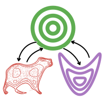
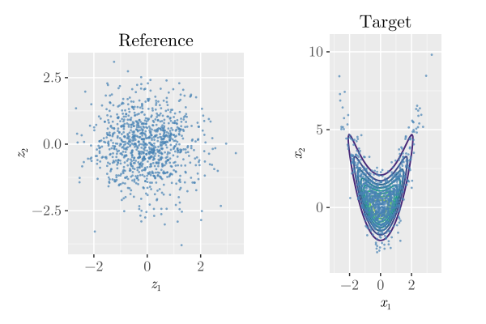

<h1 align="center">
 TransportMaps.jl
</h1>

<div align="center">

[](https://github.com/JuliaUQ/TransportMaps.jl/actions/workflows/juliaci.yml?query=branch:main)
[](https://juliauq.github.io/TransportMaps.jl/dev/)
[](https://juliauq.github.io/TransportMaps.jl/stable/)
[](https://doi.org/10.5281/zenodo.18309940)

[](https://codecov.io/github/JuliaUQ/TransportMaps.jl)
[](https://opensource.org/licenses/MIT)
[](https://github.com/JuliaTesting/Aqua.jl)
[](https://github.com/fredrikekre/Runic.jl)
</div>

A Julia implementation of triangular transport maps for variational inference.

## Quick Start

### Installation

```julia
# From Julia REPL
pkg> add TransportMaps
```

### Getting Started

Here's a simple example showing how to construct a transport map for a "banana" distribution:

```julia
using TransportMaps
using Distributions
using Statistics

# Create a 2D polynomial map with degree 2 and Softplus rectifier
M = PolynomialMap(2, 2, Normal(), Softplus())

# Set up quadrature for optimization
quadrature = GaussHermiteWeights(3, M)

# Define target density (banana distribution)
target_density(x) = logpdf(Normal(), x[1]) + logpdf(Normal(), x[2] - x[1]^2)
target = MapTargetDensity(target_density)

# Optimize the map coefficients
result = optimize!(M, target, quadrature)

# Use the fitted map as a continuous multivariate distribution
d = TransportMapDistribution(M)
samples = rand(d, 1000)  # 2 × 1000: each column is one sample

# Evaluate the fitted density and compute its moments
logpdf(d, [0.0, 1.0])
μ = mean(d)
Σ = cov(d)

# Draw reference samples for map-specific diagnostics and plots
samples_z = randn(1000, 2)
variance_diag = variance_diagnostic(M, target, samples_z)
```

`TransportMapDistribution` handles the map's fitting direction and reference
distribution automatically. Distribution methods use samples in columns;
map-level batch operations such as `evaluate` use rows. For details, see
[Transport maps as distributions](https://juliauq.github.io/TransportMaps.jl/dev/api/distributions.html).

### Visualization

When using a  [Makie](https://docs.makie.org/stable/) package such as [CairoMakie](https://docs.makie.org/dev/explanations/backends/cairomakie), the [TransportMapsMakieExt](./ext/TransportMapsMakieExt.jl) is automatically loaded.
Pre-defined plotting functions are available to visualize the results:

```julia
using CairoMakie
set_theme!(transportmap_theme())

fig = reference_target_plot(M, samples_z)
```



## Features

- **Triangular polynomial transport maps** with various polynomial bases
- **Multiple rectifier functions**: Softplus, ShiftedELU, Identity
- **Quadrature integration schemes**: Gauss-Hermite, Monte Carlo, Latin Hypercube
- **Automatic optimization** of map coefficients via KL divergence minimization
- **Distributions.jl interface** for sampling, density evaluation, moments, covariance, and entropy of fitted maps
- **Multithreaded evaluation** for processing multiple points efficiently
- **Matrix input support** for all core functions (evaluate, inverse, jacobian, etc.)

Please refer to the [documentation](https://juliauq.github.io/TransportMaps.jl/dev/) for more extensive examples and explanations.

## Related Implementation

Related implementations of transport maps are:

- [ATM](https://github.com/baptistar/ATM): Matlab code for adaptive transport maps [1]
- [MParT](https://github.com/MeasureTransport/MParT): C++-based library for transport maps [2]
- [TransportBasedInference.jl](https://github.com/mleprovost/TransportBasedInference.jl): Julia implementation of adaptive transport maps (ATM) and Kalman filters
- [SequentialMeasureTransport.jl](https://github.com/benjione/SequentialMeasureTransport.jl): Julia implementation of transport maps from sum-of-squares densities [3]
- [Triangular-Transport-Toolbox](https://github.com/MaxRamgraber/Triangular-Transport-Toolbox): Python code for the triangular transport tutorial paper [4]

### References

1. Baptista, R., Marzouk, Y., & Zahm, O. (2023). On the Representation and Learning of Monotone Triangular Transport Maps. Foundations of Computational Mathematics. https://doi.org/10.1007/s10208-023-09630-x
2. Parno, M., Rubio, P.-B., Sharp, D., Brennan, M., Baptista, R., Bonart, H., & Marzouk, Y. (2022). MParT: Monotone Parameterization Toolkit. Journal of Open Source Software, 7(80), 4843. https://doi.org/10.21105/joss.04843
3. Zanger, B., Zahm, O., Cui, T., & Schreiber, M. (2024). Sequential transport maps using SoS density estimation and $α$-divergences (No. arXiv:2402.17943). arXiv. https://doi.org/10.48550/arXiv.2402.17943
4. Ramgraber, M., Sharp, D., Provost, M. L., & Marzouk, Y. (2025). A friendly introduction to triangular transport (No. arXiv:2503.21673). arXiv. https://doi.org/10.48550/arXiv.2503.21673

## License

This project is licensed under the MIT License - see the [LICENSE](LICENSE) file for details.

## Citation

If you use TransportMaps.jl in your research, please cite using the information provided at `Cite this repository` (or see [`CITATION.cff`](CITATION.cff)).
